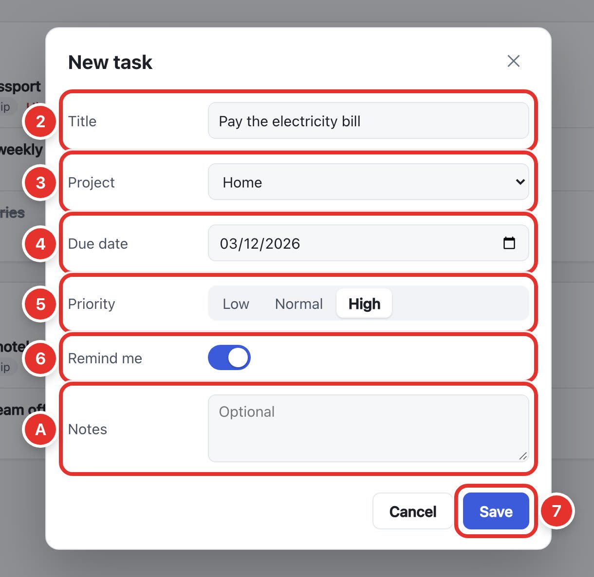
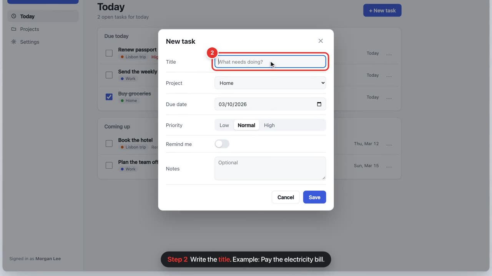
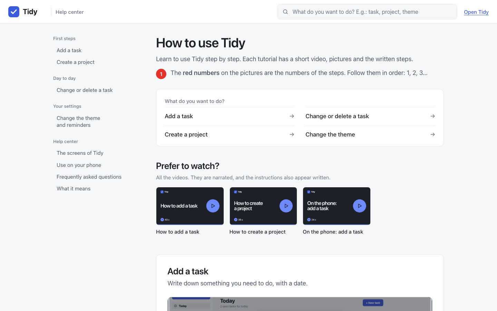
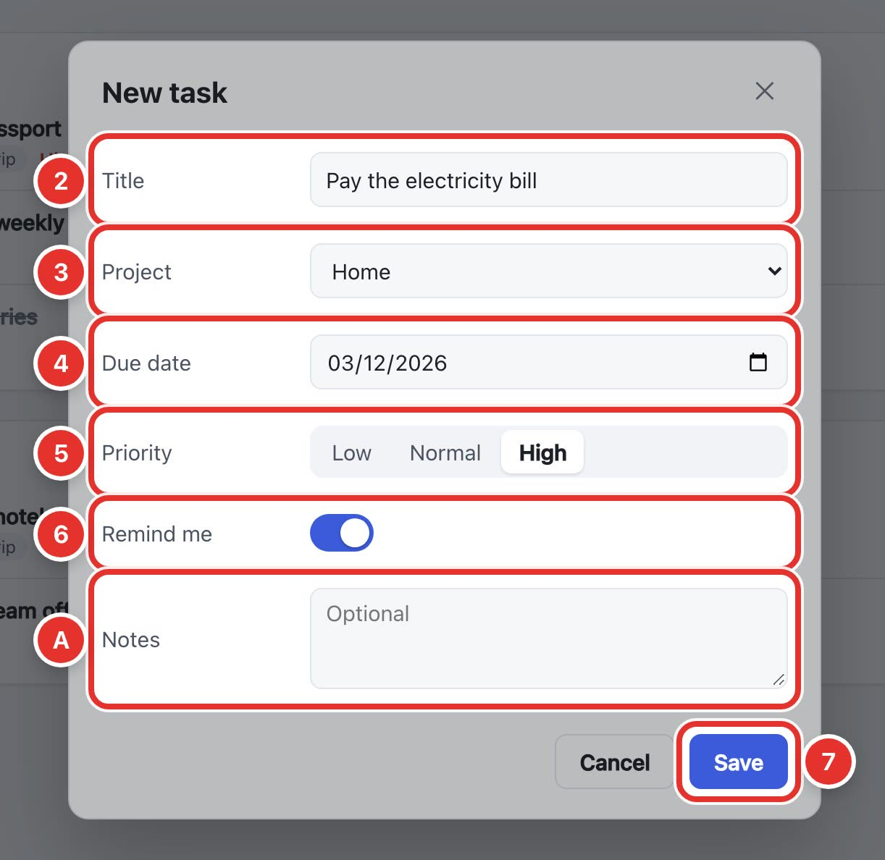

# narrated-help-center

An agent skill that builds end-user help for any web app, generated from the real app instead of drawn by hand:

- **Step pictures** with a red box around what to click, a numbered badge that matches the step in the text, and a label with an arrow on the main action. Badges and labels are placed automatically so they never cover text.
- **Narrated videos**, one task each: title card, the app in a window or a phone, smooth cursor, camera zoom, captions like "**Step 3** Click **Save**." with the button name in red. The click happens right after the narrator names the button.
- **One static help page** in the product's colors (light and dark): search, contents, quick tasks, video list with covers, numbered steps, "Before you start", "Done!", "Something went wrong?", FAQ and glossary.

Everything comes from one text module and Playwright specs that drive the app on demo data with a fixed clock, so `npm run help` regenerates it all when the UI changes — and a check fails if a step number in the text is not drawn on its picture.

| Picture | Video | Page |
| --- | --- | --- |
|  |  |  |

Optional look: darken everything but the marks (`marks.dim`).



## Install

Claude Code (personal skills, available in every project):

```sh
git clone https://github.com/arlison-pktech-ai/narrated-help-center.git ~/.claude/skills/narrated-help-center
```

Other agents that read `~/.agents/skills/` (Codex, Gemini CLI, Copilot CLI) can clone it there instead. To update: `git pull` in that folder, then `node ~/.claude/skills/narrated-help-center/scripts/scaffold.mjs --dir scripts/help --update` in each project that uses it.

## Use

Ask the agent in a web app's repository, for example: "Create a help center with step-by-step tutorials and narrated videos for this app" (or, in Portuguese, "crie a central de ajuda com tutoriais e vídeos narrados"). In Claude Code you can also run `/narrated-help-center`.

The agent follows `SKILL.md`: it installs the toolkit into `scripts/help/` with `scripts/scaffold.mjs`, makes the app deterministic (demo data, fixed clock, mocked integrations), plans and writes the tutorials, captures the pictures, then stops twice for your approval — a voice sample and one pilot tutorial — before recording the rest.

## Requirements

- Node.js 18+ and a web app that runs locally.
- `@playwright/test` with Chromium (`npx playwright install chromium`).
- ffmpeg with libx264 for the videos: on the PATH, `npm i -D ffmpeg-static`, or `FFMPEG=/path/to/ffmpeg`.
- Narration: an `ELEVENLABS_API_KEY` for the final voice; without it, the computer's voice (macOS `say` or espeak-ng) makes free drafts, or videos can be silent. Clips are cached, so recording again costs nothing. Only the caption text leaves the machine.

## Contents

| Path | What it is |
| --- | --- |
| `SKILL.md` | The workflow, writing rules, marking and video choreography, quick reference |
| `references/` | Content and writing guide, capture (demo data, fixtures, marks), video, narration, page and in-app integration |
| `scripts/scaffold.mjs` | Copies the toolkit and templates into a project, adds npm scripts and `.gitignore` entries |
| `toolkit/lib/` | The shared code: marks, recording stage, director, narration, encoder, covers, page builder, content checks, help search |
| `toolkit/templates/` | Config, content, Playwright fixtures and specs, README for the project |
| `examples/tidy/` | A complete, working setup for a small task manager |
| `assets/look/` | What the result looks like |

The help page ships with English, Portuguese (pt-BR) and Spanish strings; other languages are one block of strings in the config.
